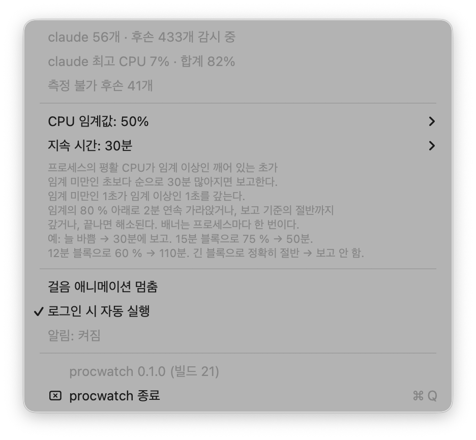

[English](README.md) · **한국어**

# procwatch


`claude` 가 띄운 모든 후손 프로세스 중 폭주한 것을 찾아 알려 주는 macOS 메뉴 막대 앱. 알리기만 하고 죽이지 않는다.

Claude Code 에 딸린 부속이 아니라 독립해서 도는 감시기다.



## 하는 일

### 감시 기준

- 대상: `claude` 프로세스의 모든 후손 프로세스
- 조건: 평활 CPU가 임계(기본 50%, 코어 1개 = 100%) 이상인 깨어 있는 초가 임계 미만인 초보다
  순으로 지속 시간(기본 30분)만큼 많아지면 보고한다. 임계 미만인 1초가 임계 이상인 1초를 갚는다.
  임계의 80% 아래로 2분 연속 가라앉거나, 보고 기준의 절반까지 갚거나, 프로세스가 끝나면 해소된다.
  임계와 지속 시간은 메뉴에서 바꾼다.
- 조치: 알림만, 자동 종료 없음

### 메뉴 막대 표시

키위새 스프라이트가 걸어 다닌다.

- 평상시: 단색 template 렌더 — 시스템이 막대 배경에 맞춰 알아서 흑백을 뒤집는다
- 폭주 감지 시: 시스템 빨강(`NSColor.systemRed`) — 값을 고정하지 않으며 라이트·다크 외형에 따라 시스템이 정한다
- 걸음 속도: `claude` 프로세스의 CPU 사용률에 연동하고, 메뉴에서 걸음을 멈출 수 있다
- 키위 대신 직접 만든 스프라이트를 쓰거나 크기를 바꿀 수 있다 — [테마](#테마) 참고

## 설치

Apple 실리콘, macOS 15 이상.

```sh
brew install --cask nharu/tap/procwatch
```

## 소스 빌드

Swift 6 툴체인이 필요하다 — Xcode 16 이상 또는 Command Line Tools.

```sh
app/scripts/build-app.sh            # app/.build/bundle/procwatch.app 을 빌드하고 서명한다
app/scripts/build-app.sh --install  # 거기에 더해 /Applications 에 복사하고 띄운다
```

스크립트는 arm64 릴리스 바이너리를 빌드해 번들로 조립하고 애드혹으로 서명한다.

## 알림 권한

첫 실행 때 알림 권한을 요청한다. 알림이 꺼져 있으면 메뉴에 procwatch 의 알림 설정을 여는 항목이
보인다.

## 로그인 시 자동 실행

메뉴의 로그인 시 자동 실행 항목으로 켜고 끈다. 앱이 `/Applications` 에 설치돼 있을 때만 쓸 수 있다.

## 테마

번들 테마는 키위 하나다. 직접 만든 스프라이트를 테마로 더할 수 있다.

- 위치: `~/Library/Application Support/procwatch/themes/<이름>/` — 폴더 이름이 테마 이름이다.
  메뉴의 **테마 폴더 열기…** 가 폴더가 없으면 만들고 Finder 로 연다.
- 프레임: PNG 네 장 `00@2x.png`, `01@2x.png`, `02@2x.png`, `03@2x.png`, 각각 정확히 48x32 px(@2x).
  폴더의 다른 파일은 읽지 않는다.
- 선택 파일 `theme.json`: `{"template": true}` 면 단색 template 이미지로 그려 시스템이 막대 배경에
  맞춰 뒤집는다. 파일이 없거나 `false` 면 프레임의 색 그대로 그린다. 모르는 필드는 무시한다.
- 폭주 표시: 컬러 테마는 시스템 빨강을 60% 덮고, 단색 테마는 키위처럼 모양 그대로 시스템 빨강으로
  칠한다.
- 메뉴의 **테마** 하위 메뉴에서 고른다. 재시작 없이 바로 바뀐다.
- 같은 하위 메뉴의 **아이콘 크기**: 기본(키위 16 pt, 사용자 테마 22 pt), 16 pt, 19 pt, 22 pt.
  키위를 포함한 모든 테마에 적용된다.
- **어두운 막대에서 밝은 외곽선**: 메뉴 막대가 어두울 때 컬러 테마 둘레에 1 px 밝은 선을 그려
  어두운 스프라이트가 묻히지 않게 한다.
- 고른 테마를 읽지 못하면(프레임 없음, 크기 틀림, `theme.json` 형식 오류, 폴더 삭제) 키위로 물러나고
  메뉴에 한 줄로 알린다. 고른 값은 남아 있어 폴더를 고치면 그 테마로 돌아간다 — 메뉴를 열 때마다 다시
  판정한다.
- 앱을 지워도 테마 폴더는 남는다.

## 제거

먼저 메뉴에서 로그인 시 자동 실행을 끈 뒤 앱을 지운다.

```sh
brew uninstall --cask procwatch
brew uninstall --zap --cask procwatch   # 설정 파일까지 지운다
```

소스로 설치했다면:

```sh
app/scripts/build-app.sh --uninstall
```

앱을 끝내고 로그인 항목을 해제한 뒤 `/Applications/procwatch.app` 과 설정을 지운다.

## 개발

```sh
swift test --package-path app
```

| 경로 | 내용 |
|---|---|
| `app/` | Swift 패키지: 앱, 핵심 라이브러리, 시험. 빌드 스크립트는 `app/scripts/` |
| `assets/` | 앱이 쓰는 키위 프레임(`frames2/kiwi/`), 원본 스프라이트 팩(`source/kiwi.zip`), 출처 문서, README 그림 |
| `packaging/homebrew/` | Homebrew cask 틀 |
| `.github/workflows/` | CI 와 릴리스 워크플로 |

`docs/` 는 git 무시 목록에 있어 레포에 들어가지 않는다. 릴리스 절차는 [RELEASING.md](RELEASING.md) 에 있다.

## 라이선스

[MIT](LICENSE). 키위 스프라이트는 CC0 이고 작가와 원본 팩은
[`assets/LICENSE-kiwi-family.md`](assets/LICENSE-kiwi-family.md) 에 있다.
