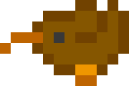

**English** · [한국어](README.ko.md)

# procwatch



A macOS menu bar app that finds runaway processes among everything `claude` spawned and tells you about them — it only alerts, it never kills.

It is a standalone monitor, not a plugin or part of Claude Code.

<!-- screenshot: menu bar dropdown -->

## What it does

### Watch rules

- Target: every descendant process of a `claude` process
- Condition: a process is reported once its awake seconds with smoothed CPU at or above the threshold
  (default 50%, 1 core = 100%) outnumber those below it by a net sustain time (default 30 min).
  Each second below the threshold pays back one second above it.
  It is cleared after 2 min in a row under 80% of the threshold, after paying back to half the
  report bar, or when the process exits. The threshold and sustain time are set from the menu.
- Action: a notification only — nothing is ever terminated

### Menu bar icon

A kiwi sprite walks in the menu bar.

- Normally: a monochrome template image — the system flips it to match the menu bar background
- When a runaway is detected: system red (`NSColor.systemRed`), left to the system for light and dark appearances
- Walking speed follows the CPU usage of the `claude` processes; the walk can be paused from the menu

## Install

Apple silicon, macOS 15 or later.

```sh
brew install --cask nharu/tap/procwatch
```

## Build from source

Requires a Swift 6 toolchain — Xcode 16 or later, or the Command Line Tools.

```sh
app/scripts/build-app.sh            # build and sign app/.build/bundle/procwatch.app
app/scripts/build-app.sh --install  # also copy it to /Applications and launch it
```

The script builds an arm64 release binary, assembles the bundle and signs it ad hoc.

## Notifications

procwatch asks for notification permission on first launch. If notifications are turned off, the
menu shows an item that opens the notification settings for procwatch.

## Launch at login

Turn launch at login on or off from the menu. The item is available only when the app is
installed in `/Applications`.

## Uninstall

First turn off launch at login from the menu, then remove the app:

```sh
brew uninstall --cask procwatch
brew uninstall --zap --cask procwatch   # also delete the settings file
```

If you installed from source:

```sh
app/scripts/build-app.sh --uninstall
```

This quits the app, removes its login item, deletes `/Applications/procwatch.app` and clears its settings.

## Development

```sh
swift test --package-path app
```

| Path | Contents |
|---|---|
| `app/` | Swift package: the app, its core library and tests; build scripts in `app/scripts/` |
| `assets/` | Kiwi frames the app uses (`frames2/kiwi/`), the source sprite pack (`source/kiwi.zip`), its license notes and the README image |
| `packaging/homebrew/` | Homebrew cask template |
| `.github/workflows/` | CI and release workflows |

`docs/` is ignored by git and is not part of the repository. Release procedures are in
[RELEASING.md](RELEASING.md).

## License

[MIT](LICENSE). The kiwi sprites are CC0; the artist and source pack are listed in
[`assets/LICENSE-kiwi-family.md`](assets/LICENSE-kiwi-family.md).
